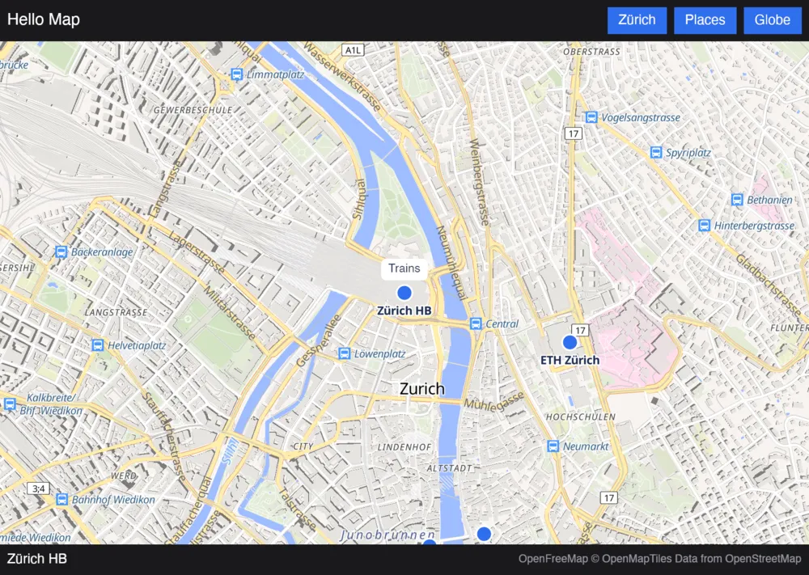

# Bevy

`maplibre-bevy` is the map in [Bevy](https://bevyengine.org) apps, drawn by mln-rs on Bevy's wgpu
device. It runs on macOS so far.



A `MapLibreMap` on a UI node draws into a texture of its own on Bevy's device, in the main world, and
the node shows it as its image, so the map composes with the rest of the UI. Bevy and mln-rs are on
the same wgpu, 30. The app declares its map as [the map model](../model.md) has it. It sends commands
such as `flyTo` and `fitBounds` as `MapCommand` messages, and hears of events such as `click` as
`MapEvent` messages, each with the map's record. The map takes the mouse with its modifier keys, a
trackpad's scroll, pinch and rotation, and touches over its node, and `MapPointer` messages hand it
input of the app's own.

## Using it

```rust
App::new()
    .add_plugins((DefaultPlugins, MapLibrePlugin))
    .add_systems(Startup, |mut commands: Commands| {
        commands.spawn(Camera2d);
        commands.spawn((MapLibreMap::new(inputs), Node { width: percent(100), height: percent(100), ..default() }));
    })
    .add_systems(Update, |mut events: MessageReader<MapEvent>| {
        for event in events.read() {
            // event.event, and the click's features in event.record
        }
    })
    .run();
```

A system changes what a map shows by changing its `MapLibreMap`'s inputs, and sends it commands with
`MessageWriter<MapCommand>`.

## Markers

A UI node with a `MapMarker`, a child of the map's node, stays at the place the content's marker of the
same id names, as GL JS's `Marker` holds an element, with its anchor and offset. It stays upright.

```rust
// in the content: "markers": {"station": {"lngLat": [8.5402, 47.3779], "anchor": "bottom"}}
commands.spawn((MapLibreMap::new(inputs), Node { flex_grow: 1.0, ..default() })).with_child((
    MapMarker { id: "station".to_owned() },
    Node { position_type: PositionType::Absolute, ..default() },
    children![Text::new("Trains")],
));
```

## Running the example

[`examples/hello-map`](https://github.com/birkskyum/maplibre-rust-ui/tree/main/bevy/examples/hello-map)
is a map of a few places in Zürich, which a tap names, with buttons that fly there, fit them in view and
turn the globe on, and a callout over the station. It needs mln-rs next to this repository, as the core
does.

```sh
cd maplibre-rust-ui/bevy
cargo run -p hello-map-bevy
HELLO_MAP_SNAPSHOTS=/tmp/hello-map cargo run -p hello-map-bevy   # a short walk, saved as PNG files
```

The walk shows no window. It draws the app into an image of its own, without winit, and saves that.

## Not done yet

- Windows, Linux, the web and phones.
- Maps in 3D scenes, as a material's texture.
- Markers that turn with the map's bearing or lie on it as it pitches.
- The content's `images`.
