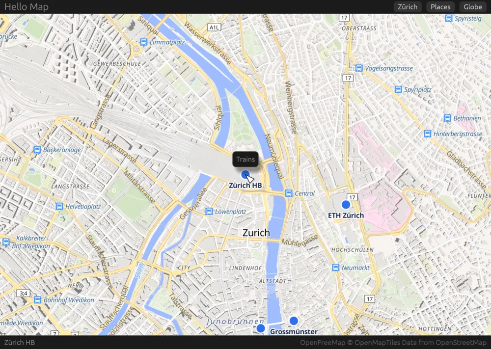

# egui

`maplibre-egui` is the map in [egui](https://www.egui.rs) apps, drawn by mln-rs on egui's wgpu
renderer. It runs on macOS so far.



The map draws into a texture of its own on egui's device before egui draws the frame, and egui shows
it like any image, so it composes with the rest of the UI. egui and mln-rs are on the same wgpu, 30,
and eframe asks for the limits mln-rs needs, so an app needs no configuration for it. The app declares
its map as [the map model](../model.md) has it, sends commands such as `flyTo` and `fitBounds`, hears
of events such as `click`, and reads the map's record. The map takes the mouse with its modifier keys,
a trackpad's scroll, pinch and rotation, and touches.

## Using it

An eframe app renders with wgpu, keeps an `EguiMap` and shows it with the renderer's state:

```rust
struct App {
    map: maplibre_egui::EguiMap,
}

impl eframe::App for App {
    fn ui(&mut self, ui: &mut egui::Ui, frame: &mut eframe::Frame) {
        let render_state = frame.wgpu_render_state().expect("eframe renders with wgpu");
        egui::CentralPanel::default().show(ui, |ui| {
            self.map.show(ui, render_state);
        });
        for event in self.map.take_events() {
            // a click's features are in self.map.record()
        }
    }
}

let options = eframe::NativeOptions { renderer: eframe::Renderer::Wgpu, ..Default::default() };
eframe::run_native("My map", options, Box::new(|_| Ok(Box::new(App { map: maplibre_egui::EguiMap::new(inputs) }))))
```

## Markers

A marker of the content holds any widget at its place, with its anchor and offset, as GL JS's `Marker`
holds an element. egui doesn't turn widgets, so a marker stays upright.

```rust
// in the content: "markers": {"station": {"lngLat": [8.5402, 47.3779], "anchor": "bottom"}}
self.map.marker(ui.ctx(), "station", |ui| ui.label("Trains"));
```

## Running the example

[`examples/hello-map`](https://github.com/birkskyum/maplibre-rust-ui/tree/main/egui/examples/hello-map)
is a map of a few places in Zürich, which a tap names, with buttons that fly there, fit them in view and
turn the globe on, and a callout over the station. It needs mln-rs next to this repository, as the core
does.

```sh
cd maplibre-rust-ui/egui
cargo run -p hello-map-egui
cargo test -p hello-map-egui -- --ignored   # a short walk offscreen, saved in target/tmp/hello-map-walk
```

The walk drives the app in egui's test harness, which renders with wgpu and shows no window. The map
loads, flies to Zürich, a tap names Zürich HB, and the places fit in view.

## Not done yet

- Windows, Linux, the web and phones, where egui also renders with wgpu.
- Markers that turn with the map or lie on it as it pitches.
