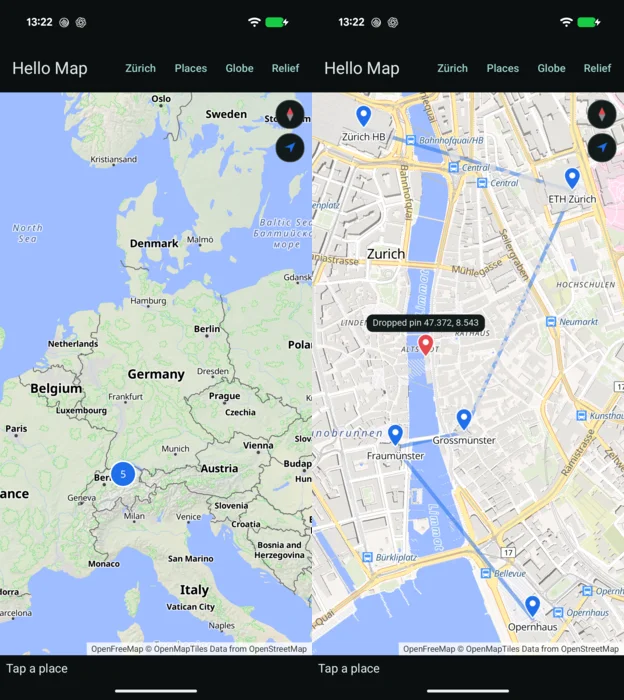

# Exact

`maplibre-exact` is the map in [Exact](https://github.com/expo/exact) apps, drawn by mln-rs on Exact's
GPU canvas. It runs on macOS, iOS and Android.



An app draws a map on a canvas:

```text
resource map = exactSurface("maplibre") as shape MapRecord
resource content = mapContent(chosen.id) as shape Content

canvas surface=maplibre(style="https://tiles.openfreemap.org/styles/liberty", longitude=8.54, latitude=47.37, zoom=11, bearing=0, pitch=0, content=content.json)
```

- `content` is the app's sources and layers in the
  [MapLibre Style Specification](https://maplibre.org/maplibre-style-spec/)'s terms, which the data
  module builds (`{"sources": {…}, "layers": […], "images": {…}}`), with images from the app's
  `assets/`. The map applies what changed, new GeoJSON data and changed paint and layout properties
  in place and the rest by adding and removing layers and sources. The content can also set the
  style's `projection` (a globe), `sky`, `light` and `terrain` over the base style's, and values for
  its `global-state` expressions in `state`.
- `markers` in the content holds the canvas's children at places on the map, by their `testId`, as GL
  JS's `Marker` holds an element (`{"callout": {"lngLat": [8.54, 47.38], "anchor": "bottom"}}`). A
  marker is the app's own Contract, so it keeps its taps and its accessibility, and Exact reports it
  where the map put it. Markers turn and tilt with the map as GL JS's do, and one without a place
  is a compass.
- `options` limits the camera and turns gestures off, with GL JS's `MapOptions` names (`minZoom`,
  `maxZoom`, `minPitch`, `maxPitch`, `maxBounds`, `interactive`, `dragRotate`, `pitchWithRotate`,
  `touchPitch`, `scrollZoom`).
- The map posts the events `events` lists (`load`, `moveend`, `click`, `contextmenu`, `error`) to
  the canvas's `message=` action, as GL JS's `map.on` subscribes to them. `contextmenu` is a
  secondary click or a long press.
- Its record, `exactSurface("maplibre")`, holds the camera at rest, whether everything in view has
  loaded, the last click and context menu with the content's features under them (a cluster's with
  the zoom it splits at), the last failure, and the style's attribution as text for the app to show
  on the map. The app reads it as a shape of its own.
- Commands go in as JSON (`jumpTo`, `easeTo`, `flyTo`, `fitBounds`, `setStyle`), such as
  ``postMessage(`{"command":"flyTo","center":[8.54,47.37],"zoom":14}`, "maplibre")``, with GL JS's
  camera options, `padding` included.

The names follow MapLibre GL JS.
[`protocol.rs`](https://github.com/birkskyum/maplibre-rust-ui/blob/main/exact/src/protocol.rs) binds
the canvas's arguments, [the map model](../model.md) is the rest of the contract, and
[`examples/hello-map`](https://github.com/birkskyum/maplibre-rust-ui/tree/main/exact/examples/hello-map)
uses all of it.

## Using it

Exact registers surfaces in the app's own GPU module, so an app names this one in `gpu/src/lib.rs`:

```rust
pub static REGISTRY: exact_gpu::Registry = exact_gpu::Registry {
    surfaces: &[("maplibre", maplibre_exact::protocol::ARITY, maplibre_exact::mln::surface)],
    shaders: &[],
};
exact_gpu::module!(REGISTRY);
```

## Running the example

Clone Exact and mln-rs next to this repository and apply the patches in
[`exact/patches`](https://github.com/birkskyum/maplibre-rust-ui/tree/main/exact/patches) to Exact, on
the commits this was last built on, Exact `09824dea` and mln-rs `1102a74c`. The patches are five.

1. Rust 1.99.1, since mln-rs needs 1.98.
2. Exact's crates take any ureq from 3.4, since mln-rs takes 3.5 and Exact pins 3.4
   ([expo/exact#426](https://github.com/expo/exact/issues/426)).
3. ibex2 builds against ureq 3.5, whose `NextTimeout` gained two fields.
4. Each child of a canvas is captured on the CPU on iOS, since the GPU capture gives markers blank or
   wrong pixels ([expo/exact#425](https://github.com/expo/exact/issues/425)).
5. Contract's lowering takes icu_locale 2.4, which mln-rs takes.

```sh
git clone https://github.com/louwers/mln-rs && git -C mln-rs checkout -b maplibre-exact 1102a74c
git clone https://github.com/expo/exact && git -C exact checkout -b maplibre-exact 09824dea
git -C exact am "$PWD"/maplibre-rust-ui/exact/patches/exact/*.patch
bun exact/scripts/exact.mjs setup
```

Then, from `maplibre-rust-ui/exact/examples/hello-map`:

```sh
bun install --frozen-lockfile      # Exact's geolocation module, which the example uses
bun exact.mjs mac --run
bun exact.mjs ios --run            # an iOS Simulator; --device on a connected iPhone, with a development profile for its bundle id
bun exact.mjs android --run        # on a connected Android phone
```

[Design](../design.md#what-exact-would-need-to-change) has what Exact would need to change.
