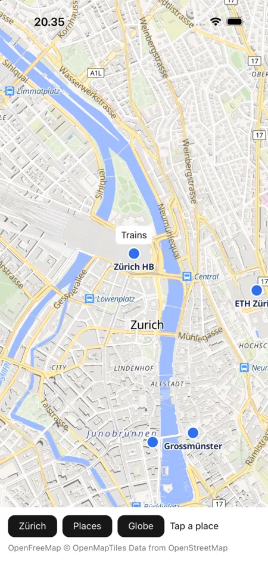

# Native Shell

`maplibre-nsh` is the map in [Native Shell](https://nsh.dev) apps, drawn by mln-rs into a native view of
its own. It runs on macOS and iOS.

{ width="300" }

The crate registers a native component, `maplibre.map`. On macOS and iOS its view's layer is a
`CAMetalLayer`, which the map renders into on a thread of its own, and the view takes the mouse and the
trackpad, or the touches, itself, with GL JS's gestures, a trackpad's pinch and rotate among them. The
app declares the map in the component's props, as [the map model](../model.md) has it, sends it
commands such as `flyTo` and `fitBounds`, and hears of its events, each with the map's record.

| Prop | Value |
|---|---|
| `style` | A style URL, or a style document |
| `camera` | `{"center": [lng, lat], "zoom": z, "bearing": b, "pitch": p}`, which moves the map when it changes |
| `content` | The app's sources and layers over the style, `{"sources": {…}, "layers": […]}` |
| `options` | Camera limits and gestures, with GL JS's `MapOptions` names (`maxZoom`, `interactive`, …) |
| `events` | The events it posts, `["load", "moveend", "click", "contextmenu", "error"]`, all of them by default |

## Using it

The app registers the map in its `#[native_components(macos)]` and `#[native_components(ios)]`
functions, which the hosts `nsh run` and `nsh package` build call, or before it runs on its own:

```rust
#[native_components(ios)]
fn components(components: &nsh_platform_ios::Components) {
    maplibre_nsh::register(components);
}

nsh_platform_macos::set_components(maplibre_nsh::register);   // before run_app, for `cargo run`
```

and places it like any element:

```rust
let map = element_ref();
maplibre_nsh::map()
    .element_ref(&map)
    .prop("style", json!("https://tiles.openfreemap.org/styles/liberty"))
    .prop("camera", json!({"center": [8.54, 47.37], "zoom": 11}))
    .prop("content", move || places(selected.get()))
    .on_native_event(move |event: &NativeEvent| {
        if event.name.as_ref() == "click" {
            status.set(event.data["click"]["features"].to_string());
        }
    })
    .flex_1()
```

Commands go through the element's ref, with GL JS's camera options:

```rust
map.command("flyTo", json!({"center": [8.54, 47.37], "zoom": 14}));
```

A TSX app registers it from its Rust crate (`nsh.json` `"rust"`) and declares it with
`nativeComponent("maplibre.map", { props: ["style", "camera", "content", "options", "events"] })`.

## Markers

Native Shell's native views hold no children, so a marker is a view of the app's own over the map.
While the content has markers, the map posts `markers` after each frame that moved one, whatever
`events` names, with where each marker at a place goes. `at_marker` holds a view there, absolutely
positioned in the map's parent, which the map fills, with its anchor on the point:

```rust
// in the content: "markers": {"station": {"lngLat": [8.5402, 47.3779], "anchor": "bottom"}}
let station = signal(MarkerPlace::default());
view().flex_1()
    .child(maplibre_nsh::map().on_native_event(move |event: &NativeEvent| {
        if event.name.as_ref() == "markers" {
            station.set(MarkerPlace::of(&event.data, "station").unwrap_or_default());
        }
    }).flex_1())
    .child(at_marker(view().child(text("Trains")), station))
```

The place comes back through the app, so the view follows the map a frame behind it. It stays
upright. The event also says how far the marker turns and squashes, which an app can apply with
Native Shell's transforms.

## Running the example

[`examples/hello-map`](https://github.com/birkskyum/maplibre-rust-ui/tree/main/nsh/examples/hello-map)
is a map of a few places in Zürich, which a tap names, with buttons that fly there, fit them in view and
turn the globe on, and a callout over the station. It needs mln-rs next to this repository, as the core
does.

```sh
cd maplibre-rust-ui/nsh
cargo run -p hello-map-nsh
HELLO_MAP_SNAPSHOTS=/tmp/hello-map cargo run -p hello-map-nsh   # a short walk, saved as PNG files
```

The walk's window opens behind the others, on a second display where there is one, since a covered
window gets no frames.

On iOS, `nsh` builds the app for the simulator, which `simctl` installs and launches:

```sh
cd examples/hello-map
nsh package --target ios-simulator -o out .
xcrun simctl install booted "out/Hello Map.app"
SIMCTL_CHILD_HELLO_MAP_WALK=1 xcrun simctl launch --console-pty booted org.maplibre.rustui.hellomap.nsh
```

`nsh run --target ios` builds, installs and launches it too, and brings the Simulator app to the
front. With `HELLO_MAP_WALK` set, the app walks and says when it reaches each step. It doesn't tap on
iOS, since only the system makes touches.

## Not done yet

- Android, where Native Shell takes components from Kotlin or Java, so the map needs a small Kotlin
  view that hands its `Surface` to Rust.
- Windows and Linux.
- Markers that follow the map within its frame, which needs native views that hold children, and
  the content's `images`.
- A check of the iOS touches beyond the code. The walks tap on macOS, and through the shared
  component in the Whisker host on iOS.
