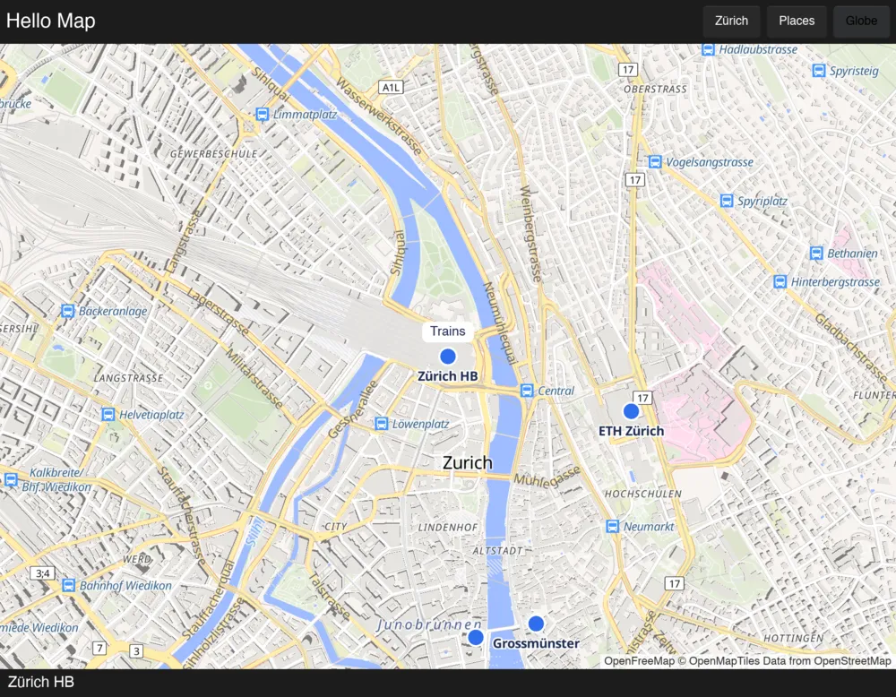

# Slint

`maplibre-slint` is the map in [Slint](https://slint.dev) apps, drawn by mln-rs on Slint's wgpu
renderer. It runs on macOS so far.



The map renders before each of the window's frames, on Slint's own wgpu device, into a texture that a
Slint `Image` shows, so it composes with the rest of the UI. The app declares its map as
[the map model](../model.md) has it, sends commands such as `flyTo` and `fitBounds`, hears of events
such as `click`, and reads the map's record. Slint reports the keyboard's modifiers with each pointer,
so shift-drag to zoom to a box and ctrl-drag to rotate work.

## Using it

The app's UI imports the map and its global from the library this crate ships, and exports the global
and the struct of markers' places:

```slint
import { MapLibre, MapLibreMap, MapLibreMarker, MapLibreMarkerPlace } from "@maplibre/maplibre.slint";
export { MapLibre, MapLibreMarkerPlace }

export component App inherits Window {
    MapLibreMap { }
}
```

Its build script gives the Slint compiler that library, whose path this crate's build hands it:

```rust
let ui = std::env::var("DEP_MAPLIBRE_SLINT_UI").unwrap();
let config = slint_build::CompilerConfiguration::new()
    .with_library_paths(std::collections::HashMap::from([("maplibre".to_owned(), ui.into())]));
slint_build::compile_with_config("ui/app.slint", config).unwrap();
```

In Rust it selects wgpu with the limits mln-rs needs, makes the map and connects it:

```rust
slint::BackendSelector::new().require_wgpu_30(maplibre_slint::wgpu_configuration()).select()?;
let app = App::new()?;
let map = Rc::new(RefCell::new(maplibre_slint::SlintMap::new(inputs)));
maplibre_slint::connect!(app, map)?;
app.run()?;
```

Commands and new inputs go through the map, `map.borrow_mut().command(fly_to_zurich)` and
`set_inputs`, and `take_events` has the events since it was last asked, with the click's features in
`record()`.

## Markers

`MapLibre.places` has the places of the content's markers, which the map sets after each frame that
moved one. A `MapLibreMarker` given a place holds its children there, as GL JS's `Marker` holds an
element. Its anchor is on the point, it turns about it when the marker turns with the map, and it hides
off the map or behind the globe. A marker that also lies on the pitched map stays unsquashed, since
Slint scales an element before it turns it.

```slint
// in the content: "markers": {"station": {"lngLat": [8.5402, 47.3779], "anchor": "bottom"}}
MapLibreMap {
    for place in MapLibre.places: MapLibreMarker {
        place: place;
        if place.name == "station": Text { text: "Trains"; }
    }
}
```

## Running the example

[`examples/hello-map`](https://github.com/birkskyum/maplibre-rust-ui/tree/main/slint/examples/hello-map)
is a map of a few places in Zürich, which a tap names, with buttons that fly there, fit them in view and
turn the globe on, and a callout over the station. It needs mln-rs next to this repository, as the core
does.

```sh
cd maplibre-rust-ui/slint
cargo run -p hello-map-slint
HELLO_MAP_SNAPSHOTS=/tmp/hello-map cargo run -p hello-map-slint   # a short walk, saved as PNG files
```

The walk's window has no frame and sits far past the edges of the screens, where the system leaves a
frameless window, so nothing shows, and its snapshots render on their own. It quits at once should the
window land on a screen.

## Not done yet

- Windows, Linux, iOS and Android, where Slint also renders with wgpu.
