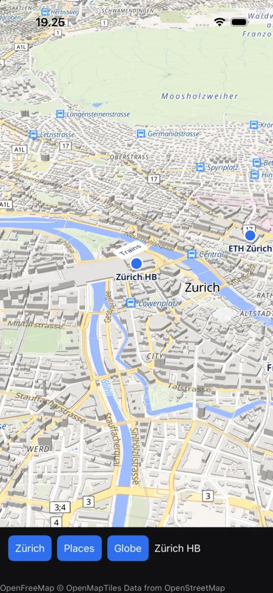

# Whisker

`maplibre-whisker` is the map in [Whisker](https://whisker.rs) apps, drawn by mln-rs into a native view
of its own. It runs on iOS and Android.

{ width="300" }

The crate is a Whisker module. Its Rust side declares the elements, `Map` and `MapMarker`. Its Swift
package
([`apple`](https://github.com/birkskyum/maplibre-rust-ui/tree/main/whisker/apple)) is the view on iOS
and macOS, whose layer is a `CAMetalLayer`, and its Gradle project
([`android`](https://github.com/birkskyum/maplibre-rust-ui/tree/main/whisker/android)) the view on
Android, a `SurfaceView`. The map renders into either on a thread of its own. The view hands the map
its props, size, touches, mouse and trackpad through the crate's C functions
([`ffi.rs`](https://github.com/birkskyum/maplibre-rust-ui/blob/main/whisker/src/ffi.rs)) or JNI
functions ([`android.rs`](https://github.com/birkskyum/maplibre-rust-ui/blob/main/whisker/src/android.rs)),
runs its frames on a display link or the choreographer while the map wants them, posts the events
each frame returns, and moves the map's markers to their places.

The app declares the map in its props, as [the map model](../model.md) has it:

| Prop | Value |
|---|---|
| `map_style` | A style URL, or a style document |
| `camera` | `{"center": [lng, lat], "zoom": z, "bearing": b, "pitch": p}`, which moves the map when it changes |
| `content` | The app's sources and layers over the style, `{"sources": {…}, "layers": […]}` |
| `options` | Camera limits and gestures, with GL JS's `MapOptions` names (`maxZoom`, `interactive`, …) |

It hears of `on_load`, `on_moveend`, `on_map_click`, `on_contextmenu` and `on_error`, each with the
map's record, and sends commands through a `MapHandle`. A click is `on_map_click`, since Whisker keeps
`on_click` for its own gesture.

## Using it

```rust
let map = MapHandle::new();
render! {
    Map(
        element_ref: map.r(),
        map_style: "https://tiles.openfreemap.org/styles/liberty",
        camera: r#"{"center": [8.54, 47.37], "zoom": 11}"#,
        content: computed(move || places(selected.get())),
        on_map_click: move |event: MapEvent| status.set(event.record()["click"].to_string()),
        style: css!(flex_grow: 1.0),
    )
}
map.fly_to(&json!({"center": [8.54, 47.37], "zoom": 14}));
```

## Markers

A `MapMarker` among the map's children holds the app's views at the place the content's marker of the
same name gives, with its anchor and offset, as GL JS's `Marker` holds an element. The view moves the
marker's node there after each frame, turns it with the map when the marker's `rotationAlignment` is
`map`, and lays it on the map as it pitches when its `pitchAlignment` is. The node keeps its taps and
its accessibility, and hides while its place is off the map or behind the globe.

```rust
// in the content: "markers": {"station": {"lngLat": [8.5402, 47.3779], "anchor": "bottom"}}
Map(map_style: STYLE, content: content, style: css!(flex_grow: 1.0)) {
    MapMarker(marker: "station", style: css!(position: PositionKind::Absolute)) {
        Text(value: "Trains")
    }
}
```

## Running the example

[`examples/hello-map`](https://github.com/birkskyum/maplibre-rust-ui/tree/main/whisker/examples/hello-map)
is a map of a few places in Zürich, which a tap names, with buttons that fly there, fit them in view and
turn the globe on, and a callout over the station. It needs mln-rs next to this repository, as the core
does, and Whisker's CLI.

```sh
cd maplibre-rust-ui/whisker/examples/hello-map
whisker run ios
whisker run android     # with ANDROID_SERIAL naming the device when several are connected
```

With `HELLO_MAP_WALK` set, the app takes a short walk on its own, which taps the map through the same
C function as the view's touches. On a simulator that is
`SIMCTL_CHILD_HELLO_MAP_WALK=1 xcrun simctl launch booted org.maplibre.rustui.hellomap`.

## Not done yet

- macOS. The view has its AppKit side, with the mouse and the trackpad, but it is unchecked, since
  Whisker's macOS app takes the front of the screen when it starts. Its markers only move, upright,
  since AppKit's node layers keep Whisker's own transform.
- A surface that Android takes away, as when the app goes to the background, isn't given back to the
  map yet.
- The content's `images`.
