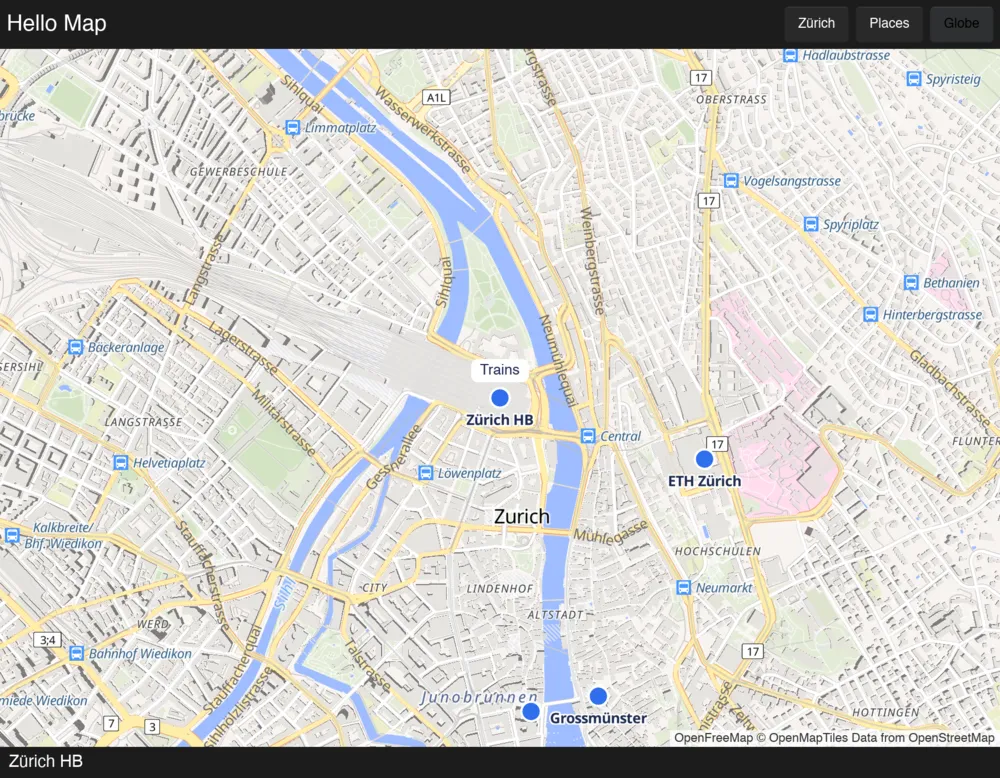
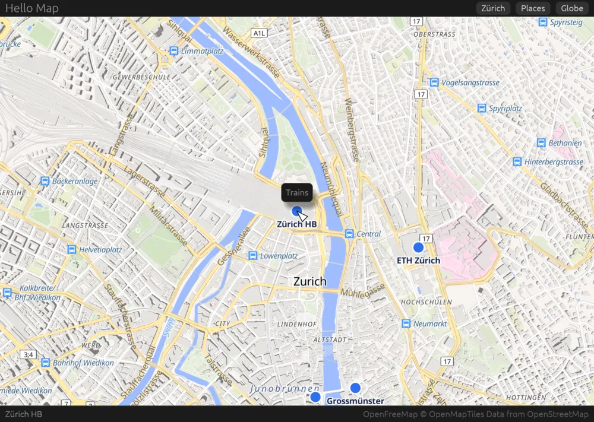
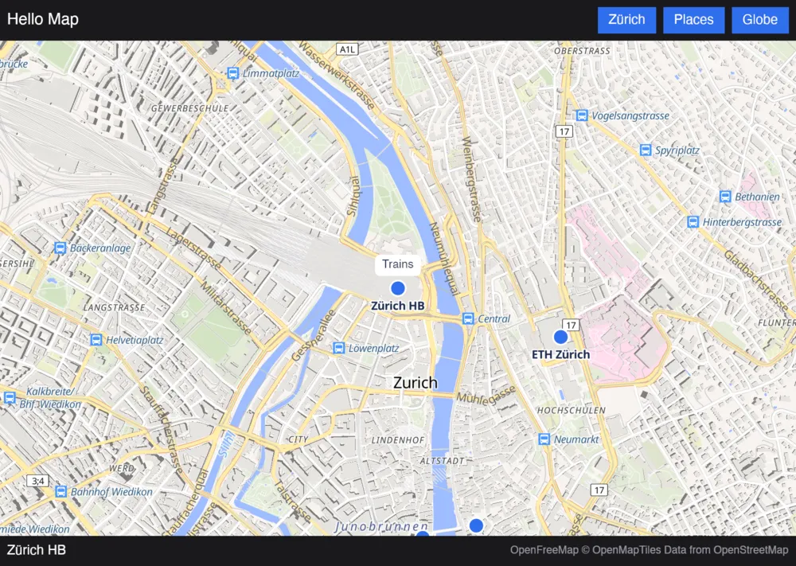
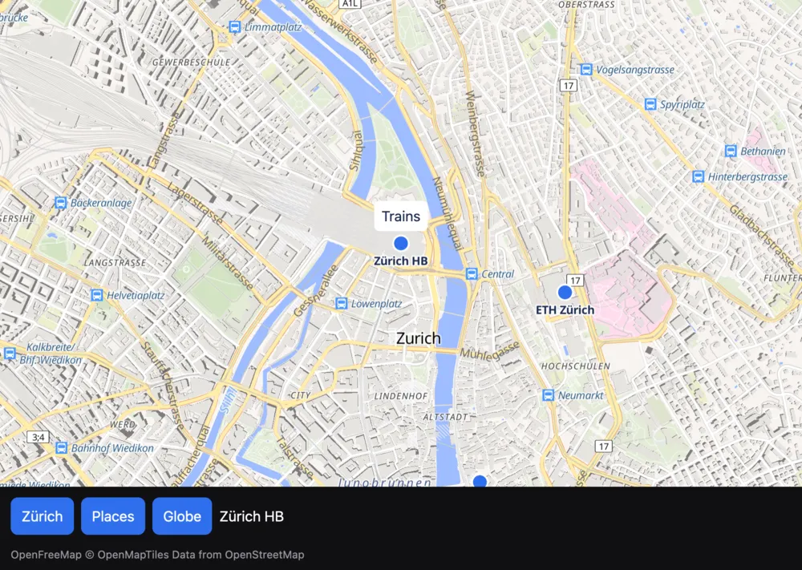
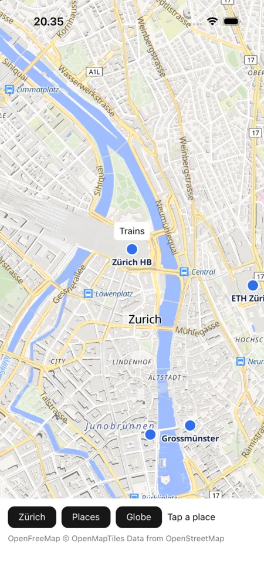
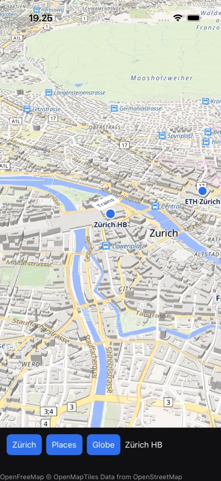
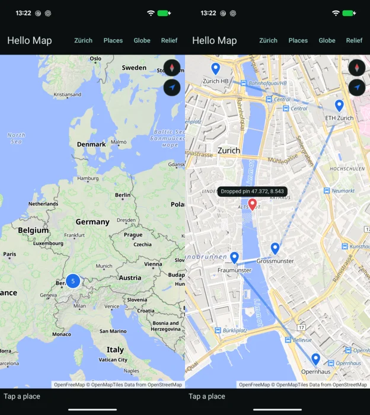

# maplibre-rust-ui

MapLibre maps for Rust UI frameworks, drawn by [mln-rs](https://github.com/louwers/mln-rs), the Rust
port of MapLibre Native.

An app declares its map the way [MapLibre Compose](https://github.com/maplibre/maplibre-compose) has it
declared, as a base style, the app's own sources and layers over it, a camera and options, all in JSON
with MapLibre GL JS's names. When the app's state changes, the map changes to match. The app sends the
map commands such as `flyTo` and `fitBounds`, hears of events such as `click` and `moveend`, and reads
the map's record. That side looks the same whichever framework hosts the map, and
[the map model](model.md) describes it.

Each framework has a host crate, which gives the map somewhere to draw and its input, and gives the app
the model in the framework's own terms. Every host's example is the same app, Hello Map, a map of a few
places in Zürich with a callout over the station.

-   **[Slint](hosts/slint.md)**, on Slint's wgpu renderer, on macOS

    ---

    

-   **[egui](hosts/egui.md)**, on egui's wgpu renderer, on macOS

    ---

    

-   **[Bevy](hosts/bevy.md)**, on a UI node drawn with Bevy's device, on macOS

    ---

    

-   **[GPUI](hosts/gpui.md)**, from IOSurfaces GPUI's Metal renderer samples, on macOS

    ---

    

-   **[Native Shell](hosts/nsh.md)**, in a native view of its own, on macOS and iOS

    ---

    { width="200" }

-   **[Whisker](hosts/whisker.md)**, in a Swift or Kotlin view, on iOS and Android

    ---

    { width="200" }

-   **[Exact](hosts/exact.md)**, on Exact's GPU canvas, on macOS, iOS and Android

    ---

    

An early prototype, which moves fast. [Getting started](getting-started.md) has the checkouts it needs,
and [Design](design.md) says how it works and what is missing.
